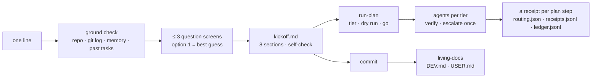

<p align="center"><strong>smartuse</strong></p>
<p align="center">Use Claude Code smartly: one line in, a planner-grade kickoff out — with a receipt for every run and every plan step.</p>
<p align="center">
<a href="LICENSE"></a>


<a href=".github/workflows/ci.yml"></a>
</p>

> gstack gives you roles. Ruflo gives you a swarm. **smartuse gives you a receipt.**

A planner needs paths, owners, absolute dates, non-goals, gated deliverables and open questions with owners. Nobody types that by hand every time. Half of it is in your repo; the other half is in your head. `make-prompt` greps the first half and asks you a few multiple-choice questions for the second. The result is a spec a fresh session can execute. The other pieces keep the work honest afterwards: feature docs updated from the diff (Claude calls `living-docs` after a commit it makes; for your own commits, run `/smartuse:living-docs`), a reply voice you choose, a safety floor that fires even in bypass mode, a ledger that shows what every run — and every step of the plan — cost, a heartbeat that says whether Claude is working, waiting on an agent, waiting on you, or stalled, and **recall**: after a long session is compacted, the summary is not a source — the job's files must be reopened before anything is sent.


<p align="center"><sub>Replay of the real 2026-10-21 bench run (<code>bench/results-example/2026-10-21-csv-export/</code>); rendered from the captured output by <code>scripts/render-demo.py</code>, nothing mocked.</sub></p>

## Install (30 seconds)

```text
/plugin install smartuse --marketplace justyk99/smartuse
```
Or from your shell: `claude plugin marketplace add justyk99/smartuse && claude plugin install smartuse@smartuse`. Then type `/smartuse:make-prompt <one line about the work>`.

## What you get

| Skill | You type | You get |
|---|---|---|
| `make-prompt` | `/smartuse:make-prompt add PWA install to the player site` | a ground check of your repo (reference code, owners from git log, lockfiles, missing tools, past tasks, incidents in memory), ≤ 3 screens of multiple-choice questions where option 1 is Claude's evidence-backed guess and "I don't know" is always allowed, an 8-section kickoff saved in your task folder, a 5-line summary for your team, a 14-line self-check. `quick` = no questions, every guess marked `assumed:`. |
| `run-plan` | `/smartuse:run-plan <task.md> --routing safe` (add `--until-done` for the loop) | a pre-flight (each unit's tools and input files must be on this machine, else `needs-machine`), a dry-run routing table (unit → judgment / build / mechanical / command / verify → model → why), then foreground agents with a model per tier (a `command` unit is one shell command run in the background, no model; since 0.7.6 the skill does not pre-approve one that starts with `bash`, so it asks in default mode), one escalation, a fresh-agent review of every delegated build, **a receipt per plan step** (tier · model · your override · outcome · escalation · review verdict · the agent's real tokens, attached by a hook), one progress line per unit. `--routing off` is the baseline for your own A/B. `--until-done` keeps going without "go": a Stop gate refuses to end the turn while units or the repo check are unfinished; it stops only for a real human question, a double failure, a rule gate or the cap. |
| `living-docs` | Claude calls it after a commit it makes; for your own commits run `/smartuse:living-docs <task-folder> <commit>` or add that line to your commit procedure | `DEV.md` (developers) + `USER.md` (operators) per feature, only the sections the diff touched, from the diff + task notes; forked on a cheaper model |
| `reply-style` | `/smartuse:reply-style` | 7 voices (lcd · bluf · engineer · teacher · minimal · plain · memo) with who-they-are-for and pros/cons, installed as a Claude Code output style |
| `ledger` | `/smartuse:ledger` | every run's minutes, fresh vs cached input, output tokens and self-check, with medians. Written by a Stop hook from the session transcript; costs 0 model tokens |
| `receipts` | `/smartuse:receipts [task]` | one row per plan step of a run: `# · step · tier · model · override · outcome · esc · verify · calls · in · out · check`, plus each model's share of agent output. Tokens come from the SubagentStop hook, never estimated; closed runs are archived so a task's receipts survive the next run. 0 model tokens |
| `status` | `/smartuse:status` (add `install` for the terminal status line) | one deterministic line from the heartbeat hook: `working · waiting on agent: general-purpose 4m12s · step 3/6 build·opus "tests"`, `waiting on you · 3m`, `NEEDS YOU: which rounding rule?`, `STOPPED · handed off 20:41 (builder) — nothing will wake this session`, `stalled? no activity 6m`. Hooks on every tool call, agent start/stop, prompt, stop and notification write `status.json`; 0 model tokens, one Python start per event (~55 ms on Linux; on Windows a start can take seconds, see Windows). Since 0.6.1 the three tool-event handlers run in the background, so Claude does not wait for them. The plugin also ships a `subagentStatusLine` that names the plan step on each agent row |
| `doctor` | `/smartuse:doctor` | proof that the hooks are live: Python, hooks registered, heartbeat, bash-guard and file-guard each PASS or FAIL with the fix, plus the guard level and any rules switched off. Claude tries one harmless canary per guard; a guard that is live denies it. 0 model tokens to compute the report |
| `bash-guard` | on in the light level (default) and in Strict; see Switches | denies pipe-to-shell, `sudo`, recursive deletes of a tree, world-writable chmod, credential-file reads, destructive SQL through shell tools, force-push, svn revert, writes to the human-only files, and (0.7.0) **a script that calls a per-call billed API until the owner gave a go** — and names the safe alternative. It covers the Bash, PowerShell and Monitor tools (the same rules read the PowerShell text; 0.7.0 adds PowerShell download-then-run, `Remove-Item -Recurse -Force` of a root, and the owner's files, see Switches and Honest limits). 1,341 regression cases in `run.sh`, 1,436 more for the paid check. `file-guard` keeps the adapter, the pin file, the launcher's remembered interpreter, the paid-run counter and the session transcripts read-only for the model |
| `recall` | always on; the gate needs `sources:` plus `publish:` or `publish_tools:` in `.claude/smartuse.local.md`, the session-start note needs `handoff:` | **the fresh-source gate:** a send command (`publish: python send.py`, typed in Bash or PowerShell) or an upload tool (`publish_tools: mcp__*__file_upload`) is denied until every source file has a Read after the last compaction — `bash-guard: fresh-source — 2 of 3 sources not opened since the last compaction (14:02): photos/a.jpg, photos/b.jpg. Open each with Read, then retry. Nothing was sent.` **At the squeeze:** the summarizer is told to keep the source paths and your last prompts verbatim; right after it, Claude is told "the summary is not a source" and which files to reopen; the status line counts squeezes (`· squeezed 2× (last 14:02)`). **At session start:** the first lines of your `handoff:` note and a stale line when it is older than the last commit. 0 model tokens; nothing is stored but counts and paths |

## Switches
Three options, set by you in Claude Code: `/plugin configure smartuse@smartuse`. Light is the default, also when you set nothing.

| Option | What it does | Default |
|---|---|---|
| Strict guards | every rule on, the wait gate on, Rules off ignored, and the guards fail closed (an unexpected error in a guard denies the call) | off |
| Rules off | rule names to switch off, separated by commas or blanks; ignored in Strict | empty |
| Wait gate | the wait gate: a hand-off with nothing armed to wake the session is blocked once | off |

- **Light frees only two rules.** `force-with-lease` (`git push --force-with-lease` runs; `git push --force` is still denied) and `claude-json` (a read of `~/.claude.json` runs, as in 0.6.0). The `secrets-dir` rule stays on in light; switch it off by name if a folder called `secrets` in your repos holds none.
- **Each deny ends `[rule <name>]`.** Type that name into Rules off and the rule is off. The names: `pipe-to-shell` · `download-exec` · `sudo` · `rm-root` · `chmod-open` · `credential-file` · `secrets-dir` · `claude-json` · `sql-destructive` · `force-push` · `force-with-lease` · `svn-revert` · `fake-tty` · `ps-download-exec` · `ps-rm-root` (the last two are new in 0.7.0) · `paid` (new in 0.7.0, see below).
- **Five rules cannot be switched off:** `human-only`, `trust-pin`, `config-switch`, and, new in 0.7.0, `settings-file` and `owner-file`. Their deny ends `[rule <name>, always on]`. A misspelt name changes nothing; `/smartuse:doctor` names it. Since 0.7.0 `rules_off=paid` is a known name there too.
- **`paid` is a check, not a rule, and it sits last.** In Strict it is always on. In light (the default) it is on only in a repo whose adapter has a paid line (`paid:`, `paid_scripts:`, `paid_hosts:`, `paid_free:`, or `paid_guard: on`); Rules off can switch it off in light. Every deny of it ends `[rule paid]`.
- **Changed in 0.7.0: what a command may do with a settings file.** `settings-file` allows a plain reader (`cat`, `grep`, `git diff` and the like, a copy from the file, `python -m json.tool <one file>` with flags only) and denies any other command that names a Claude Code settings file. It replaces the 0.6.1 list of writers, which was never complete.
- **Changed in 0.7.0: `owner-file`.** The paid-run counter and its lock and claim files, the adapter (`.claude/smartuse.local.md`), the trust file (`trusted-checks.json`) and the launcher's `interpreter` file may be read from the shell and nothing else, in the Bash and PowerShell tools (readers only: `sed`, `awk`, `python` on the adapter are refused).
- **A switched-off rule is shown.** Session start prints `smartuse: rules off: <names>`, and the status line adds `· N rules off`. A switch from Strict to light is not shown there; doctor prints the level.
- **Two honest commands run at every level:** a download piped into `python -m json.tool`, and the word `sudo` inside a commit, tag or note message, an `echo`, `printf`, `grep` or `rg` argument, or a `gh` title or body. A download into any other interpreter, or `sudo` as a command, is still denied.

**Claude cannot change the switches for itself.**
- The hooks read the level from their own environment, which a command cannot change.
- `file-guard` denies a Write, Edit or MultiEdit of a Claude Code settings file that changes this plugin's options, its on/off entry, the switch that turns all hooks off, or an `env` entry named `CLAUDE_PLUGIN_OPTION_…`.
- `bash-guard` (the always-on `config-switch` rule) denies the plugin command's configure, enable, disable, uninstall and marketplace-remove verbs for this plugin, and an install that sets options.
- The `settings-file` rule (0.7.0) denies any shell command that names a settings file, except a plain reader. Reading a settings file stays allowed.

The limit, by class: both read text. A write hidden inside another program, or a command built at run time, is not seen. A command that only quotes such a text, in a message for example, is denied too. The plugin's own installed files are not guarded: editing them turns the guards off. Details: `SECURITY.md`.

## How it works



## Measured (2026-10-15, Claude Code 2.1.300, Max plan)

| What | Result |
|---|---|
| `claude plugin eval`, all 10 cases, each with its own turn and time limits (0.5.0, 2026-10-25, Claude Code 2.1.310, Linux CI, `--ablation none --scaffold`, one run per case) | **10 of 10 pass** (1.00 each) · $0.93 per full run, 213 s. `plugins/smartuse/evals/results/2026-10-25-0.5.0-ci/` |
| `claude plugin eval`, all 10 cases (0.5.0 working tree, 2026-10-22, Claude Code 2.1.308, `--ablation none --scaffold`, one run per case) | **10 of 10 pass** (1.00 each) · $0.83 per full run. The two new cases for the one-session pattern (`kickoff-two-sessions`, `run-plan-wrong-machine`) pass 3 of 3 runs each with the 0.5 skills and score 0.00 and 0.67 on 3 of 3 without the new text; the incident's reply ("paste this into the builder; I'll ping you when it's done") fails the judge on every vote of a control case. `plugins/smartuse/evals/results/2026-10-22-0.5.0-m4/` |
| `claude plugin eval`, all 8 cases, with vs without the plugin (0.4.0, 2026-10-22, Claude Code 2.1.308, one run per case) | **8 of 8 pass with it** (1.00 each); without: 0.50 for `bash-guard-sudo` and `living-docs-no-root`, 0.00 for the other six · mean gain **+0.88** · $1.01 per full run (both arms). Scoring first found three skill defects, fixed before this run: make-prompt's template had a deliverable with no gate and its self-check could read "about 9/14"; reply-style never told the model where its catalogue is. The two fixed cases then passed 3 of 3 runs each. `plugins/smartuse/evals/results/2026-10-22-0.4.0/` (0.2.0: 4 of 4, +0.88) |
| `make-prompt quick` on three real asks (two production repos + the bench repo) | 0.9 – 1.8 min · 3.1k – 3.9k output tokens · 130k – 205k cached reads each · self-check 11/13 – 12/13 (the receipt's denominator at the time; the list has 14 lines and the receipt says /14 since 0.4.0) |
| `run-plan` first real unit | tiered to Haiku (7 calls, 24k output tokens), reported **blocked** by a read-only database rule instead of working around it |
| `run-plan --until-done`, bench repo, one line in | kickoff 14/14 → endpoint + 4 tests built (11/11 pass) → verified end to end → stopped with a precise human question (pre-existing lint gap). $1.30, 5.6 min, 19 turns. `bench/results-example/` |
| **0.3.0 run (2026-10-21, 2.1.306), same ask, headless** | kickoff 14/14 ($1.57, 2.4 min) → 6 steps, no "go" in between: router + mount + 4 tests (6/6), live curl, three fresh-agent reviews "no gaps", docs on haiku, step 6 blocked by rule (never commits). **A receipt per step with hook-attached tokens**: agent out 10.0k (fable 40% · haiku 45% · sonnet 13%). $3.72, 6.4 min, 22 turns. `bench/results-example/2026-10-21-csv-export/` |
| **A/B, routed vs not, 2026-10-22, model pinned to Opus, 4 bench asks** | same kickoff per ask, then `run-plan --until-done` per dial: median cost `off` $1.35 · `safe` $1.10 · `aggressive` $1.26 — **−24 % median per ask on both routed dials**; agent output not lower (cheaper models wrote more); tests green in 11 of 12 runs (one aggressive run left 3 failing tests); 3 of 4 asks ended on a real human question on every dial. n=4 on one fixture repo: a direction, not a claim. `bench/results-example/2026-10-22-ab-run3/` (and run 2, n=1: −17 % / −31 %) |
| bash-guard · ledger + receipts · until-done · file-guard · heartbeat hooks · bench A/B dry run · the watcher · the wait gate · the fresh-source gate · recall · the paid check | `bash plugins/smartuse/hooks/tests/all.sh` prints `run 1178 · ledger 46 · until-done 50 · file-guard 107 · heartbeat 179 · ab 36 · watch 63 · wait 196 · fresh 758 · recall 203 · paid 852` (PASS lines per suite, every one green, each suite run alone on the author's Windows laptop, 2026-11-14, 0.7.0 before release; the badge counts the ten hook suites, `ab` left out: 3632 on this run) |
| The fresh-source gate's cost (0.6.0, the author's Windows laptop) | the transcript pass takes 84 ms on a 13 MB session and 1.65 s (median of 5) on the largest local transcript, 270 MB; a Python start ~350 ms. The check has one 4 s deadline that starts when the hook starts; past it a matched send is denied, never let through |
| A command built to be slow (0.6.0, the author's Windows laptop) | 8,000 unclosed `<<` openers (48 KB) followed by `git push`: the security review measured 4.84 s + 5.39 s in the two heredoc scans, past the 10 s hook timeout, which lets a call through. Now the heredoc scan is capped, the deadline starts with the hook, and a command too big or too tangled to read counts as a send while the sources are unopened: the same command is denied in 0.31 s (median wall of 5 runs, interpreter start included; the maintainer's laptop, 2026-11-10) |

**What Claude waits for, per call (0.6.1).** Hooks that Claude waits on are counted from `hooks.json`; seconds are method M (`docs/notes/light-fast-plan.md` §4, F0): the debug log's `Hooks:` lines, the longest blocking smartuse hook before a call plus the longest after it. Both columns: Claude Code 2.1.322, the author's Windows laptop, 2026-11-10, the slower of two runs.

| Per call | Hooks waited on, 0.6.0 → 0.6.1 | Seconds waited, 0.6.0 | Seconds waited, 0.6.1 |
|---|---|---|---|
| Bash | 3 → 1 | 0.83 | 0.41 |
| Read | 2 → 0 | 0.76 | 0.00 |
| Edit | 3 → 1 | 0.98 | 0.35 |
| Stop (end of a turn) | 4 starts, side by side, both versions | 0.54 | 0.56 |

The plan's target for Bash was 0.35 s or less; it is 0.41 s, because one guard start still costs about 0.4 s on this laptop (starting Python alone is 0.17 s). Stop is unchanged: its four hooks still run side by side.

**0.7.0** (method M, Claude Code 2.1.326, the same laptop, 2026-11-17, 4 runs per setup, pooled medians): Bash 0.357 s on 0.6.1, 0.360 s on 0.7.0 with no paid line, 0.359 s with a paid line; Edit 0.289, 0.304, 0.307 s; Read 0.00 s. The guard grew to about 3,100 lines in 0.7.0; `py.sh` now keeps each hook's compiled bytecode, so a call no longer recompiles it.

Re-run them yourself: `claude plugin eval plugins/smartuse --runs 1 --scaffold --allow-tools Bash Skill Read Grep Glob Agent Write` (`--scaffold` runs the `scaffold.sh` of the two one-session cases, which stage a small repo and a task folder in the case's working directory; Linux needs `bubblewrap` + `socat` for the sandbox, and `TMPDIR` set to a directory outside `/tmp`: the eval sandbox denies writes to `/tmp`, where it would otherwise put its own temp dir, and every skill's `!` line then fails with "Read-only file system") and `bench/run.sh` (a sample repo with a planted rounding bug + 5 asks). The regression suites: `bash plugins/smartuse/hooks/tests/all.sh` — every hook suite plus the bench A/B dry run, one summary line, nothing spent.

## Honest limits
- Skills and styles are instructions. The hook is the only enforcement.
- Since 0.7.6 a skill pre-approves only its own launcher commands (the launcher, one hook script and one option) and a few single programs such as `ls` and `date`; any other `bash …` command in its turn asks, and no skill pre-approves `python3`. bash-guard does not see a skill's `!` lines (Claude Code runs them before any hook). What was measured, and on which Claude Code, is in `SECURITY.md`, "What the skills pre-approve (0.7.6)".
- `make-prompt quick` reads a lot: budget 1–8 minutes and real plan usage per kickoff. It refuses one-file fixes.
- Subagents cannot ask you questions. Unknowns come back as `unknown: … → who`.
- The wait gate is off by default since 0.6.1; it runs in Strict, or when the Wait gate option is on (see Switches). It blocks a hand-off with nothing armed to wake the session — once. Its reply trigger is a pattern match (`paste this into the builder`, `I'll ping you`, …), and any live background task counts as the watcher, so it catches the plain case, not every case. `wait_gate: off` in the adapter turns it off. A scheduled check-in counts as a watcher, but one can fail to arrive (seen on 2026-10-22: one of this project's own check-ins was refused at delivery): a background watcher in the same session, such as `hooks/watch.py`, is the surer wake-up.
- recall counts a Read; it cannot tell whether the file was understood. The summary's quality is the model's. Gated: the named send commands through Bash, PowerShell and Monitor (also behind `timeout`, `env`, `nohup`, `sudo`, `winpty`, `setsid`, `uv run`, `poetry run`, `$(…)`, a here-string, `echo … | bash`, a git alias; a `-c` / `eval` / `iex` / `cmd /c` / `-Command` string handed to another shell is not read into: it counts as a send, see the next limit) and upload tools whose name holds upload, send, publish, post, share or submit; not gated: a click on a page's own Send button, and a send hidden inside another program (`python -c`, a script that calls the send). A Read that failed does not count as opening a source; a Read whose result never arrived does. From Claude Code 2.1.314 (confirmed on 2.1.321), Monitor commands reach the same check. A `**` or `*` source pattern that meets a link is refused with the link named (a Python `venv/` or a `jobs/latest` link): name the job's folder instead. Every limit, with the reasons: `docs/notes/recall-design.md`.
- **A command the gate cannot read counts as a send while the sources are unopened.** Reading shell and PowerShell quoting ever deeper is a race a text gate cannot win, so when a command is too big or too tangled to read, it is treated as a send until you have re-read the sources. The classes: a very long command (over 32 KB), heredocs past the scan cap, several command substitutions, a `-c` / `eval` / `iex` / `cmd /c` / `-Command` string handed to another shell, and in PowerShell typographic quotes or dashes, escaped quotes, a block comment (`<#`), and `Start-Process` (or `start` / `saps`) as a standalone word anywhere in the command (its arguments are not read). With `publish:` listed and a source unopened (right after a compaction, or before the sources are first opened), a PowerShell command that holds the word `Start-Process`, `saps` or `start` anywhere is denied once until the sources are re-read, including `npm start`, a `$start` variable or the word inside a quoted string. A backtick escape inside that word is not caught yet (parked for 0.6.2). The reason names which one and says to open the sources or simplify the command. Once the sources are opened, such a command is read as any other. It only counts as a send when `publish:` is listed.
- **Accepted over-denies**, one turn each: right after a compaction and before the sources are re-read, an unusual but harmless command in those classes is denied once. The PowerShell match is coarse (a publish word anywhere in a statement counts), so an unquoted `Write-Host git push`, a publish word in a data here-string or array, or on its own line inside a multi-line quoted argument is denied too; the quoted `Write-Host "git push"` is allowed.
- **What the gate does not see.** A command built at run time (variables, brace or glob expansion, `$'…'` quoting). Some other ways of handing a command to another shell or interpreter are not yet recognised as such (other spellings of the same launchers, text fed on standard input, process substitution, shell functions and traps); they are parked for 0.6.2 and built when a real miss is reported. On Bash, at or under the heredoc cap, a quoted word that spans lines is read whole (a known limit). The older safety rules reach PowerShell in 0.7.0 as far as `ps-download-exec`, `ps-rm-root` and `owner-file` read it (limits in `SECURITY.md`); the body of a `-File` script is still not read by them. The frozen older rules are slow on a very long, dense command, so when the sources are opened or there is no adapter, such a command can outlast the hook's timeout, and a hook that times out lets the call through (planned: every rule linear). The three rules split out in 0.6.1 reuse their parents' patterns and are slow on a long dense text too (seconds at 30 KB). A Python start slower than about 6 s has the same effect. Each limit, in its own words: `docs/notes/recall-design.md`.
- **The paid check stops honest mistakes, not a forged approval.** It reads text. A go in the adapter is the strong form: the adapter is human-only. The vendor's own hard limits (a spend cap or a rate limit set at the provider) are the backstop, because a missed deny costs money. By class, it does not see: a command handed to another shell in a way it does not parse (`eval`, `source`, a download kept in a variable and run later, `pwsh -Command "…"`, `& $var`); `python -m <module>` and helper modules (a go matches the script by file name; a module a script loads is not followed); a script past 256 KB (only the first part is read); a script's own child processes; a folder change it does not count (a tool's own folder flag, a folder from a variable, a folder past the 6 nearest; `cd sub && python client.py` is followed); a shortened count flag (read in full spelling only); a delete of the state folder, which resets the count. It also over-denies: a paid run beside a PowerShell loop counts as a repeat, and `sed`, `awk` or `python` on the adapter are refused. Each limit, with the reason: `SECURITY.md`.
- With Claude Code's sandbox on, Bash cannot write under `~/.claude`, so the skills' state writes (a skill's ledger receipt, run-plan's plan) are refused inside it — seen in the eval sandbox. The hooks run outside the sandbox and still write the per-agent receipts and the heartbeat.
- Routing is measured on **four** bench asks so far (median cost −24 % on both routed dials, agent output not lower, one aggressive run left failing tests); real-repo runs decide whether that holds. The cost column is the session's own `total_cost_usd`, not an estimate. The per-step receipts exist so that every published number has a line of evidence per step.

## Windows
The PowerShell tool is on by default on Windows for claude.ai accounts, and the guard and the fresh-source gate cover it (coarse match: a publish word anywhere in a statement counts). `CLAUDE_CODE_USE_POWERSHELL_TOOL=0` turns the tool off, so every command runs through Bash. The hooks run through `plugins/smartuse/hooks/py.sh`, which picks `python3`, `python` or `py -3` (on a stock Windows install `python3` is the Microsoft Store stub). Git Bash is required: Claude Code runs hook commands through it on Windows. `HOME` from Git Bash is honoured; state lives under `~/.claude/smartuse/`. Each hook event costs one Python start, and on Windows a start can take seconds (0.4–3.6 s on the author's laptop): the launcher probes for an interpreter once and then remembers which name worked (`python3 -I`, `python -I` or `py -3 -I`: the name plus a mark that it started in Python's isolated mode, never a path, in `~/.claude/smartuse/interpreter`; both guards keep that file human-only; a file from 0.7.4 or earlier holds the bare name and is proven again once and rewritten), so the Store stub is not started on every event. Measured there: about 2 s per hook event before, 0.5–1.8 s after (the rest is that machine's own Python start, under memory pressure).

Since 0.6.1 Claude waits on one hook per Bash call (the guard) and none per Read. The heartbeat's tool events run in the background, and on Windows the heartbeat now locks its state file too.

**No Python.** If none of `python3`, `python` or `py -3` runs, the hooks cannot run, and the session starts anyway. Session start then prints one sentence:
```text
smartuse: Python 3 was not found (tried python3, python, py -3). Its guards, gates and status line are OFF. Install Python 3.9 or newer and restart Claude Code.
```
With Strict guards on, a guarded call is refused with a similar sentence instead of passing silently.

## Configure per repo (optional)
`.claude/smartuse.local.md` with YAML frontmatter: `vcs`, `task_root`, `archive_root`, `docs_root`, `task_template`, `svn_flags`, `author`, `jira_cli`, `check` (the runnable check `run-plan --until-done` must pass), `wait_gate` (`off` switches the wait gate off for this repo, even in Strict or with the Wait gate option on). Without the file the skills detect git/svn and the usual folders.

recall reads four more keys, one line each, in the frontmatter or the body (values split on commas):
```text
sources: jobs/demo/plan.pdf, jobs/demo/photos/*.jpg
publish: python send.py, git push
publish_tools: mcp__*__file_upload, mcp__*__upload_image
handoff: docs/STATUS.md
```
`sources:` are this job's real files: relative to the repo (globs; `**` reaches any depth) or absolute, plain local paths only (a share, a device path, a link, a `:` after the drive letter or a part made only of dots is refused). `publish:` are the commands that send the job's output: a pattern matches a command whose first word is the same program (`python`, `python3` and `py` are one) and whose later words include the pattern's, in order, a script by the end of its path (`python send.py` matches `python -u C:/repo/send.py`). In PowerShell the same patterns are matched more coarsely: the program may be any word of a statement, and names compare without regard to case. `publish_tools:` are tool names (`fnmatch` globs). `handoff:` is one file inside the repo whose first 15 lines start every new, cleared or resumed session. No `sources:` means no gate. The file is human-only: Claude cannot write it, so you write these lines yourself.

The paid check (0.7.0) reads five more keys, all optional, written by you. Any of the first four arms the check in light; Strict is always armed.
```text
paid: render.py x 10, cap RM5, count --n, test ok
paid_scripts: render.py, tools/batch.py only --pictures --polish
paid_hosts: api.example-images.test
paid_free: --dry-run, --mock, tests/check_*.py
paid_guard: on
```
- **What counts as paid.** A command whose script (the first 256 KB of the file it runs), inline code or command line names one of the built-in image and LLM API hosts (OpenAI, Stability, Replicate, fal, Gemini, Ideogram, Anthropic), one of their named key variables (`OPENAI_API_KEY` and the like) or an import of their SDKs. `paid_hosts:` adds hosts of your own. It never opens a `.env` and never uses the network. A paid call is denied until a go covers it. The reason names the script and the line to add.
- **The go, `paid:`.** `paid: <script> x <runs>[, cap <amount>][, count <flag> | count none][, test ok]`, one line, or a list under `paid:` (`  - render.py x 3, cap RM1`). The script is matched by file name. `cap` is text for you: it is shown and never measured, so **runs are counted and money is not**. The first run after a go must make one output: a plain-literal count flag set to 1, or `count <flag>` (your flag) or `count none` on the line. Run 2 and later wait until the line says `test ok`; adding `, test ok` keeps the count, any other change to the line starts a new count. Once `test ok` has been seen for a go (a run was counted under it), it stays for that go: taking it off the line later does not bring the wait back. A script run in a loop, or under `xargs` / `parallel` / `watch`, is denied: run it once per call.
- **Typed in the chat.** The same go can be typed as a line of its own in the session, from the laptop or the phone: `paid go: render.py x 3, cap RM1`. `test ok` (after the one output) opens runs 2 and later; `paid stop` refuses the next run even with runs left, and is stored in the counter. Only your own typing counts: a line relayed from another session, a tool result, a headless run, a subagent report or Claude's own text is never a go, and a subagent's call needs the adapter line. The guard reads the last 4 MB of the session transcript on a paid call; the adapter line is the stronger form (limits in `SECURITY.md`).
- **`paid_scripts:`** names scripts that are paid whatever their source says: a bare file name (any folder) or a project-relative path or pattern (`*` and `?` stay inside one folder). `<script> only <flag> ...` makes the script paid only when one of those flags is on the command line (a shortened spelling that a parser accepts counts); a go line never carries `only`.
- **`paid_free:`** names runs that are free: allowed, not counted, no go. A flag (two dashes) frees a run of any paid script that carries it, as the exact word or `flag=value` with `1`, `true` or `yes`, before a bare `--`; it is your word that every paid script of the project treats that flag as free. A project-relative path or pattern frees the script at that path (never one that `paid_scripts:` or a go names). A run with a `$VAR`, glob or substitution beside the flag is not free.
- **Folders.** The guard looks for a relative script under the session's folder and under each folder the command names before it (`cd polish && python client.py`, `pushd`, `Set-Location`, `env -C`, `--dir=…`), and reads every file it finds; a signal in any of them makes the run paid. A `paid_scripts:` path item covers only its own file, and a `paid_free:` path frees a run only when every found file matches it. List a script by file name in `paid_scripts:` and it is caught in any folder.

`check` accepts exactly these shapes, verbatim: `npm test` · `pnpm test` · `yarn test` · `bun test` · `pytest [paths]` · `make test` · `make check` · `cargo test` · `go test ./...` · `dotnet test` · `mvn test` · `gradle test`. Anything else is refused and the gate says so: `npm run x`, `npx …`, `python -m pytest`, flags, pipes, `&&`. A `bash <script>` check runs only when you pin it by hash with `until-done.py --trust "bash <script>"` (run from the repo; it prints the `sudo` commands, you run them) in a root-owned `/etc/smartuse/trusted-checks.json`: Linux/macOS only, needs sudo, not on Windows.

Everything the hooks write lives under `~/.claude/smartuse/`, never inside your repo. The file-by-file list is in **What it reads and writes** below, and how to remove it all is in **Uninstall**.

## Uninstall
Type these two commands in your own terminal. Claude cannot run them for you: the guard's always-on `config-switch` rule refuses the plugin command's uninstall and marketplace-remove verbs for smartuse, so the switch stays yours.

```text
claude plugin uninstall smartuse@smartuse
claude plugin marketplace remove smartuse
```
They are Claude Code's own plugin commands (`claude plugin --help` lists them). They take out the plugin: its hooks, skills and styles. Restart Claude Code afterwards.

What stays, because Claude Code does not know about it. Delete what you want gone:

| What | Where | How |
|---|---|---|
| **The state folder**: every file in the table below | `~/.claude/smartuse/` (under `HOME`; on Windows your user folder, or the `HOME` you set) | `rm -r ~/.claude/smartuse` in a Bash shell (Git Bash on Windows, macOS, Linux) · `Remove-Item -Recurse $HOME\.claude\smartuse` in PowerShell |
| A reply style you installed with `/smartuse:reply-style` | `~/.claude/output-styles/<name>.md` (`.claude/output-styles/` in a repo, if you used `--project`); `<name>` is one of `lcd` · `bluf` · `engineer` · `teacher` · `minimal` · `plain` · `memo` | delete the file you chose, and delete the `"outputStyle"` key in `~/.claude/settings.json` (in `.claude/settings.local.json` for `--project`) or run `/output-style Default` |
| The status line, if you ran `/smartuse:status install` and said yes | the `statusLine` key of `~/.claude/settings.json`, its command names `heartbeat.py --statusline` | delete that key |
| Each repo's adapter | `.claude/smartuse.local.md` | you wrote it (smartuse never creates it): delete it, or leave it, nothing reads it without the plugin |
| The trust file, only if you pinned a `bash <script>` check (Linux and macOS; Windows has none) | `/etc/smartuse/trusted-checks.json` | `sudo rm /etc/smartuse/trusted-checks.json`, then `sudo rmdir /etc/smartuse` |

The kickoffs, `DEV.md` and `USER.md` that the skills wrote into your repo on request are your documents; smartuse leaves them. Nothing re-creates the state folder once the plugin is gone: only its hooks and its `ledger.py` write there.

## What it reads and writes
The hooks are small Python files that import no network library; this is their whole list, checked against the code for 0.7.1. The limits of what the guards see are in `SECURITY.md`.

Since 0.7.5 the hooks start in Python's isolated mode wherever that Python accepts the flags: no `PYTHON*` variable, user site folder or site folder of the interpreter is read, and the working folder is not an import folder (what that does not cover is in `SECURITY.md`, "How the hooks start Python").

**Reads.** Every hook reads the event Claude Code sends it (tool name and input, session id, project folder, transcript path). Beyond that:

| Hook | Reads |
|---|---|
| `heartbeat` | its own state folder: `status.json`, `routing.json`, `wait.json`. Of an event it keeps the tool name, ids, agent type and times, never a tool's arguments, file contents or prompts. `--doctor` also reads the plugin's `plugin.json` and `hooks.json`, and looks for the name `paid-runs.json` in the project's two possible state folders (never its content) |
| `ledger` | the session transcript and the session's agent transcripts (to sum token usage since the skill's `started_at`), `pending.json`, `routing.json` |
| `until-done` | `routing.json`; the `check:` line of the adapter; on Linux and macOS `/etc/smartuse/trusted-checks.json` and the pinned script |
| `wait-gate` | the session transcript (one pass); `wait_gate:` in the adapter; `.git/HEAD` for the branch name |
| `recall` | the session transcript (your last prompts, the compaction records); `sources:`, `publish:`, `publish_tools:` and `handoff:` in the adapter; the first 15 lines of the `handoff:` file; `.git/logs/HEAD` for the time of the last commit |
| `bash-guard` | the command's text; the adapter; the session transcript (Reads since the last compaction for the fresh-source gate, the last 4 MB for a typed `paid go:`); the names of the files `sources:` lists (never their content); `paid-runs.json`, and that name in the project's other state folder (never its content); and, for the paid check (on with a paid line in the adapter, or in Strict), the first 256 KB of a script a command runs and the folders the command names |
| `file-guard` | the settings file Claude is about to change (to compare its three switch values) and it resolves the path being written (links, short names); it opens no other file |

On Windows, the six hooks that name the state folder may also read one registry value, `LongPathsEnabled`, read only, and only when a state folder of more than 232 characters already exists under the full key (it decides whether that folder is kept, see `SECURITY.md`).

**Writes.** The hooks write only under `~/.claude/smartuse/`, never inside your repo. `<key>` is the repository's full path with every character outside `A-Z a-z 0-9 . _ -` replaced by `-`, so two folders with the same name never share a state folder. A path too long for its state folder to hold its files (a whole file path may hold 259 characters on Windows, one name 255 elsewhere) gets a shorter name: its last 40 characters, `-`, and 12 hex digits of a hash of the whole path. 0.3.0 keyed the folder by name alone; nothing writes `projects/<folder name>/` any more, and `/smartuse:receipts` still lists its old runs, marked as shared.

| File | Holds | Written by |
|---|---|---|
| `ledger.jsonl` | one line per run, all repos | `ledger` (Stop) |
| `projects/<key>/status.json` | the heartbeat: what Claude is doing now | `heartbeat` (every event) |
| `projects/<key>/status.lock` | the heartbeat's write lock | `heartbeat` |
| `projects/<key>/routing.json` | the active or latest run-plan run | `ledger.py --put` (run-plan); `ledger` adds agent tokens, `until-done` the block count |
| `projects/<key>/receipts.jsonl` | one line per agent | `ledger` (SubagentStop) |
| `projects/<key>/runs/` | closed runs, archived | `ledger` when run-plan closes |
| `projects/<key>/receipt.<agent>.done` | one empty marker per agent, so its receipt is written once; removed when run-plan closes (an aborted run leaves them: harmless) | `ledger` |
| `projects/<key>/pending.json` | a skill's hand-off, consumed at Stop | `ledger.py --put` (a skill); `ledger` claims it by renaming it to `pending.<pid>.claimed` and deletes it once its line is written, or at once when its content is bad; one that still cannot be read after five tries (another hook holds it) is left |
| `projects/<key>/recall.json` | recall's squeeze count, the last squeeze time and the sources unopened then: counts and paths, never a command | `recall` |
| `projects/<key>/wait.json` | the wait gate's outcome at the last Stop with a hand-off open, shown by the status line | `wait-gate` |
| `projects/<key>/wait-block.json` | the scopes the wait gate has already blocked once | `wait-gate` |
| `projects/<key>/paid-runs.json` | the paid check's counter: per go line, the script, the runs allowed and used, the cap text; never a command | `bash-guard` |
| `projects/<key>/paid-runs.lock` | its lock while it is written | `bash-guard` |
| `projects/<key>/paid.<id>.done` | one empty marker per counted call, so a run is counted once | `bash-guard` |
| `*.tmp` beside a file above | the temporary name of an atomic write, renamed at once; a crash can leave one | the same hook |
| `interpreter` | the name of the Python the launcher proved, with a mark that it started isolated (`python3 -I`, `python -I` or `py -3 -I`), so later events skip the probe | `py.sh` |

The shell may read the paid counter, its lock and the markers, and nothing else, and the file tools refuse them. Delete the whole `projects/<key>/` folder and the paid count starts again, so the way to stop paid runs for good is to remove the go line. Outside `~/.claude/smartuse/`, two things are written, neither by a hook's own logic: Python's compiled bytecode of the hooks, in `hooks/__pycache__/` inside the plugin's folder (a speed-up; with `PYTHONDONTWRITEBYTECODE` or a folder that cannot be written, none), and, when a session runs `watch.py`, what `git fetch` writes in your clone (`FETCH_HEAD` and `refs/remotes/<remote>/<branch>`).

**Network.**
- The seven hooks make no network call and start no process of their own except `until-done`, below. The paid check reads a script's text for host names and never connects to them.
- `until-done` runs the `check:` line of your adapter in your repo: one of the fixed shapes (`npm test`, `pytest`, and so on) or a script you pinned by hash, with no shell and a 5-minute limit. What that command does is its own.
- `watch.py` is not a hook: a session starts it in the background after a hand-off (the wait gate's reason suggests the command). With `--git` it runs `git ls-remote` against the remote you name, every 60 seconds by default, and `git fetch` of that one branch when its head changes. With `--file` it only looks for a file. It stops on a signal or at `--max` (4 hours by default).
- The skills are instructions to Claude, not code. What Claude does for them (a `living-docs publish` pushes a page, for example) goes through Claude Code's own tools and your permission prompts, and is not in this list.

## Repository map
```
plugins/smartuse/      the plugin: skills/ (8: make-prompt · run-plan · living-docs · reply-style · ledger · receipts · status · doctor) · output-styles/ (7) ·
                       hooks/ (7: bash-guard with the fresh-source gate · file-guard · ledger · until-done · wait-gate · heartbeat · recall;
                       watch.py, the watcher a session runs in the background; tests/ with all.sh) · evals/ (10 cases) · docs/
bench/                 reproducible mini-benchmark: sample repo + 5 asks + runner
docs/research/         the reading behind the design (reply styles, security profiles, the routing landscape)
docs/notes/            18: design notes with test logs (make-prompt, living-docs, receipts, heartbeat) · the 1.0 audit (audit-2026-10-22) · one session that delegates (built in 0.5: watch.py, the wait gate, the steering) · the 0.5.1 launcher fix (plan, brief) · recall (0.6.0: the design and build contract) · lighter, faster, switchable (0.6.1: brief, plan) · the paid-call guard (0.7.0: plan, briefs) · relay guards (rule 4 built in 0.7.0; the rest a proposal, not built)
docs/releases/         release notes per version
scripts/               3: term-scan.py — private-term scan before a public push, and its test · render-demo.py — the demo gif from a captured run
```

## Roadmap
- **0.2**: make-prompt · run-plan · living-docs · reply-style · ledger · bash-guard · evals · bench.
- **0.3** (released 2026-10-22): a receipt per plan step with the user-override field, `/smartuse:receipts` per task, `run-plan --until-done` with its deterministic Stop gate, `file-guard`.
- **0.4** (released 2026-10-22): the heartbeat (`/smartuse:status`, status line, agent rows) · `bench/ab.sh`, the routed-vs-not A/B runner with the per-step receipts as evidence · receipts by model · state writes without a permission prompt · Windows.
- **0.5** (released 2026-10-25; 0.5.1 the same day): one session that delegates as the main pattern — the session where your files and tools are keeps the judgment and hands the mechanical work to background tasks and cheaper subagents, and a watcher plus a wait gate make sure a session that hands work to another one is woken when it is done (`docs/notes/one-session-design.md`).
- **0.6** (released 2026-11-10): recall — "the summary is not a source": the fresh-source gate, recall at the squeeze and the handoff pointer (`docs/notes/recall-design.md`).
- **0.6.1** (released 2026-11-11): lighter, faster, switchable — Claude waits on fewer hooks, two honest commands run, a missing Python is said aloud, `/smartuse:doctor`, and a switch only you can flip (`docs/notes/light-fast-plan.md`).
- **0.7.0** (released 2026-11-23): the paid-call guard (`docs/notes/paid-guard-plan.md`) with the adapter go, the run cap and free runs; settings files and the owner's files read-only from the shell; PowerShell parity for the older rules; a quote in a `#` comment no longer hides the next lines. The owner can also type `paid go:`, `test ok` and `paid stop` in the chat. Then: real-repo A/B runs, "30 days of receipts", the measured post. Proposed: relay guards for second-machine setups (`docs/notes/relay-design.md`).

## Contributing
Issues and PRs welcome — see [CONTRIBUTING.md](CONTRIBUTING.md). Every change to a hook needs its test (`plugins/smartuse/hooks/tests/`; `bash plugins/smartuse/hooks/tests/all.sh` runs every suite). Security reports: [SECURITY.md](SECURITY.md).

## Credits and prior art
Built on Claude Code's official mechanisms only (skills, hooks, output styles, plugin evals). Ideas acknowledged: Anthropic's "let Claude interview you" pattern, the Living Docs template (Diew), superpowers `brainstorming` (obra), NawkaRouter / claude-router / gearbox for the routing-ladder shape, gstack for proving that a story and a 30-second install matter, Shape Up for appetite · rabbit holes · no-gos. Details and sources in `docs/research/`.

## Author
JustYK — a full-stack developer who grew this inside a legacy ASP.NET back office and a Vue 3 / .NET 8 rebuild, one incident at a time. MIT.
