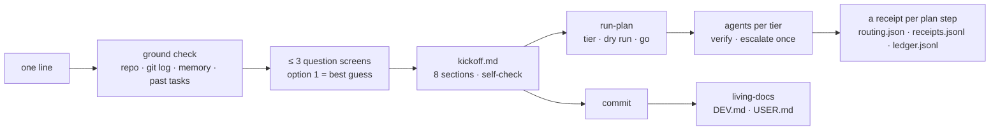

<p align="center"><strong>smartuse</strong></p>
<p align="center">Use Claude Code smartly: one line in, a planner-grade kickoff out — with a receipt for every run and every plan step.</p>
<p align="center">
<a href="LICENSE"></a>


<a href=".github/workflows/ci.yml"></a>
</p>

> gstack gives you roles. Ruflo gives you a swarm. **smartuse gives you a receipt.**

A planner needs paths, owners, absolute dates, non-goals, gated deliverables and open questions with owners. Nobody types that by hand every time. Half of it is in your repo; the other half is in your head. `make-prompt` greps the first half and asks you a few multiple-choice questions for the second. The result is a spec a fresh session can execute. The other pieces keep the work honest afterwards: feature docs updated from the diff (Claude calls `living-docs` after a commit it makes; for your own commits, run `/smartuse:living-docs`), a reply voice you choose, a safety floor that fires even in bypass mode, a ledger that shows what every run — and every step of the plan — cost, a heartbeat that says whether Claude is working, waiting on an agent, waiting on you, or stalled, and **recall**: after a long session is compacted, the summary is not a source — the job's files must be reopened before anything is sent.


<p align="center"><sub>Replay of the real 2026-10-21 bench run (<code>bench/results-example/2026-10-21-csv-export/</code>); rendered from the captured output by <code>scripts/render-demo.py</code>, nothing mocked.</sub></p>

## Install (30 seconds)

```text
/plugin install smartuse --marketplace justyk99/smartuse
```
Or from your shell: `claude plugin marketplace add justyk99/smartuse && claude plugin install smartuse@smartuse`. Then type `/smartuse:make-prompt <one line about the work>`.

## What you get

| Skill | You type | You get |
|---|---|---|
| `make-prompt` | `/smartuse:make-prompt add PWA install to the player site` | a ground check of your repo (reference code, owners from git log, lockfiles, missing tools, past tasks, incidents in memory), ≤ 3 screens of multiple-choice questions where option 1 is Claude's evidence-backed guess and "I don't know" is always allowed, an 8-section kickoff saved in your task folder, a 5-line summary for your team, a 14-line self-check. `quick` = no questions, every guess marked `assumed:`. |
| `run-plan` | `/smartuse:run-plan <task.md> --routing safe` (add `--until-done` for the loop) | a pre-flight (each unit's tools and input files must be on this machine, else `needs-machine`), a dry-run routing table (unit → judgment / build / mechanical / command / verify → model → why), then foreground agents with a model per tier (a `command` unit is one shell command run in the background, no model), one escalation, a fresh-agent review of every delegated build, **a receipt per plan step** (tier · model · your override · outcome · escalation · review verdict · the agent's real tokens, attached by a hook), one progress line per unit. `--routing off` is the baseline for your own A/B. `--until-done` keeps going without "go": a Stop gate refuses to end the turn while units or the repo check are unfinished; it stops only for a real human question, a double failure, a rule gate or the cap. |
| `living-docs` | Claude calls it after a commit it makes; for your own commits run `/smartuse:living-docs <task-folder> <commit>` or add that line to your commit procedure | `DEV.md` (developers) + `USER.md` (operators) per feature, only the sections the diff touched, from the diff + task notes; forked on a cheaper model |
| `reply-style` | `/smartuse:reply-style` | 7 voices (lcd · bluf · engineer · teacher · minimal · plain · memo) with who-they-are-for and pros/cons, installed as a Claude Code output style |
| `ledger` | `/smartuse:ledger` | every run's minutes, fresh vs cached input, output tokens and self-check, with medians. Written by a Stop hook from the session transcript; costs 0 model tokens |
| `receipts` | `/smartuse:receipts [task]` | one row per plan step of a run: `# · step · tier · model · override · outcome · esc · verify · calls · in · out · check`, plus each model's share of agent output. Tokens come from the SubagentStop hook, never estimated; closed runs are archived so a task's receipts survive the next run. 0 model tokens |
| `status` | `/smartuse:status` (add `install` for the terminal status line) | one deterministic line from the heartbeat hook: `working · waiting on agent: general-purpose 4m12s · step 3/6 build·opus "tests"`, `waiting on you · 3m`, `NEEDS YOU: which rounding rule?`, `STOPPED · handed off 20:41 (builder) — nothing will wake this session`, `stalled? no activity 6m`. Hooks on every tool call, agent start/stop, prompt, stop and notification write `status.json`; 0 model tokens, one Python start per event (~55 ms on Linux; on Windows a start can take seconds, see Windows). The plugin also ships a `subagentStatusLine` that names the plan step on each agent row |
| `bash-guard` | always on | denies pipe-to-shell, `sudo`, recursive deletes of a tree, world-writable chmod, credential-file reads, destructive SQL through shell tools, force-push, svn revert, writes to the human-only files — and names the safe alternative. It covers the Bash and PowerShell tools (the same rules read the PowerShell text; PowerShell's own write and delete verbs are not rules yet, see Honest limits). 269 regression cases. `file-guard` keeps the adapter, the pin file and the launcher's remembered interpreter read-only for the model |
| `recall` | always on; the gate needs `sources:` plus `publish:` or `publish_tools:` in `.claude/smartuse.local.md`, the session-start note needs `handoff:` | **the fresh-source gate:** a send command (`publish: python send.py`, typed in Bash or PowerShell) or an upload tool (`publish_tools: mcp__*__file_upload`) is denied until every source file has a Read after the last compaction — `bash-guard: fresh-source — 2 of 3 sources not opened since the last compaction (14:02): photos/a.jpg, photos/b.jpg. Open each with Read, then retry. Nothing was sent.` **At the squeeze:** the summarizer is told to keep the source paths and your last prompts verbatim; right after it, Claude is told "the summary is not a source" and which files to reopen; the status line counts squeezes (`· squeezed 2× (last 14:02)`). **At session start:** the first lines of your `handoff:` note and a stale line when it is older than the last commit. 0 model tokens; nothing is stored but counts and paths |

## How it works



## Measured (2026-10-15, Claude Code 2.1.300, Max plan)

| What | Result |
|---|---|
| `claude plugin eval`, all 10 cases, each with its own turn and time limits (0.5.0, 2026-10-25, Claude Code 2.1.310, Linux CI, `--ablation none --scaffold`, one run per case) | **10 of 10 pass** (1.00 each) · $0.93 per full run, 213 s. `plugins/smartuse/evals/results/2026-10-25-0.5.0-ci/` |
| `claude plugin eval`, all 10 cases (0.5.0 working tree, 2026-10-22, Claude Code 2.1.308, `--ablation none --scaffold`, one run per case) | **10 of 10 pass** (1.00 each) · $0.83 per full run. The two new cases for the one-session pattern (`kickoff-two-sessions`, `run-plan-wrong-machine`) pass 3 of 3 runs each with the 0.5 skills and score 0.00 and 0.67 on 3 of 3 without the new text; the incident's reply ("paste this into the builder; I'll ping you when it's done") fails the judge on every vote of a control case. `plugins/smartuse/evals/results/2026-10-22-0.5.0-m4/` |
| `claude plugin eval`, all 8 cases, with vs without the plugin (0.4.0, 2026-10-22, Claude Code 2.1.308, one run per case) | **8 of 8 pass with it** (1.00 each); without: 0.50 for `bash-guard-sudo` and `living-docs-no-root`, 0.00 for the other six · mean gain **+0.88** · $1.01 per full run (both arms). Scoring first found three skill defects, fixed before this run: make-prompt's template had a deliverable with no gate and its self-check could read "about 9/14"; reply-style never told the model where its catalogue is. The two fixed cases then passed 3 of 3 runs each. `plugins/smartuse/evals/results/2026-10-22-0.4.0/` (0.2.0: 4 of 4, +0.88) |
| `make-prompt quick` on three real asks (two production repos + the bench repo) | 0.9 – 1.8 min · 3.1k – 3.9k output tokens · 130k – 205k cached reads each · self-check 11/13 – 12/13 (the receipt's denominator at the time; the list has 14 lines and the receipt says /14 since 0.4.0) |
| `run-plan` first real unit | tiered to Haiku (7 calls, 24k output tokens), reported **blocked** by a read-only database rule instead of working around it |
| `run-plan --until-done`, bench repo, one line in | kickoff 14/14 → endpoint + 4 tests built (11/11 pass) → verified end to end → stopped with a precise human question (pre-existing lint gap). $1.30, 5.6 min, 19 turns. `bench/results-example/` |
| **0.3.0 run (2026-10-21, 2.1.306), same ask, headless** | kickoff 14/14 ($1.57, 2.4 min) → 6 steps, no "go" in between: router + mount + 4 tests (6/6), live curl, three fresh-agent reviews "no gaps", docs on haiku, step 6 blocked by rule (never commits). **A receipt per step with hook-attached tokens**: agent out 10.0k (fable 40% · haiku 45% · sonnet 13%). $3.72, 6.4 min, 22 turns. `bench/results-example/2026-10-21-csv-export/` |
| **A/B, routed vs not, 2026-10-22, model pinned to Opus, 4 bench asks** | same kickoff per ask, then `run-plan --until-done` per dial: median cost `off` $1.35 · `safe` $1.10 · `aggressive` $1.26 — **−24 % median per ask on both routed dials**; agent output not lower (cheaper models wrote more); tests green in 11 of 12 runs (one aggressive run left 3 failing tests); 3 of 4 asks ended on a real human question on every dial. n=4 on one fixture repo: a direction, not a claim. `bench/results-example/2026-10-22-ab-run3/` (and run 2, n=1: −17 % / −31 %) |
| bash-guard · ledger + receipts · until-done · file-guard · heartbeat hooks · bench A/B dry run · the watcher · the wait gate · the fresh-source gate · recall | `bash plugins/smartuse/hooks/tests/all.sh` prints `run 272 · ledger 46 · until-done 40 · file-guard 26 · heartbeat 121 · ab 36 · watch 63 · wait 187 · fresh 722 · recall 210` (PASS lines per suite, every one green, each suite run alone, 2026-11-10) |
| The fresh-source gate's cost (0.6.0, the author's Windows laptop) | the transcript pass takes 84 ms on a 13 MB session and 1.65 s (median of 5) on the largest local transcript, 270 MB; a Python start ~350 ms. The check has one 4 s deadline that starts when the hook starts; past it a matched send is denied, never let through |
| A command built to be slow (0.6.0, the author's Windows laptop) | 8,000 unclosed `<<` openers (48 KB) followed by `git push`: the security review measured 4.84 s + 5.39 s in the two heredoc scans, past the 10 s hook timeout, which lets a call through. Now the heredoc scan is capped, the deadline starts with the hook, and a command too big or too tangled to read counts as a send while the sources are unopened: the same command is denied in 0.31 s (median wall of 5 runs, interpreter start included; the maintainer's laptop, 2026-11-10) |

Re-run them yourself: `claude plugin eval plugins/smartuse --runs 1 --scaffold --allow-tools Bash Skill Read Grep Glob Agent Write` (`--scaffold` runs the `scaffold.sh` of the two one-session cases, which stage a small repo and a task folder in the case's working directory; Linux needs `bubblewrap` + `socat` for the sandbox, and `TMPDIR` set to a directory outside `/tmp`: the eval sandbox denies writes to `/tmp`, where it would otherwise put its own temp dir, and every skill's `!` line then fails with "Read-only file system") and `bench/run.sh` (a sample repo with a planted rounding bug + 5 asks). The regression suites: `bash plugins/smartuse/hooks/tests/all.sh` — every hook suite plus the bench A/B dry run, one summary line, nothing spent.

## Honest limits
- Skills and styles are instructions. The hook is the only enforcement.
- `make-prompt quick` reads a lot: budget 1–8 minutes and real plan usage per kickoff. It refuses one-file fixes.
- Subagents cannot ask you questions. Unknowns come back as `unknown: … → who`.
- The wait gate blocks a hand-off with nothing armed to wake the session — once. Its reply trigger is a pattern match (`paste this into the builder`, `I'll ping you`, …), and any live background task counts as the watcher, so it catches the plain case, not every case. `wait_gate: off` in the adapter turns it off. A scheduled check-in counts as a watcher, but one can fail to arrive (seen on 2026-10-22: one of this project's own check-ins was refused at delivery): a background watcher in the same session, such as `hooks/watch.py`, is the surer wake-up.
- recall counts a Read; it cannot tell whether the file was understood. The summary's quality is the model's. Gated: the named send commands through Bash, PowerShell and Monitor (also behind `timeout`, `env`, `nohup`, `sudo`, `winpty`, `setsid`, `uv run`, `poetry run`, `$(…)`, a here-string, `echo … | bash`, a git alias; a `-c` / `eval` / `iex` / `cmd /c` / `-Command` string handed to another shell is not read into: it counts as a send, see the next limit) and upload tools whose name holds upload, send, publish, post, share or submit; not gated: a click on a page's own Send button, and a send hidden inside another program (`python -c`, a script that calls the send). A Read that failed does not count as opening a source; a Read whose result never arrived does. From Claude Code 2.1.314 (confirmed on 2.1.321), Monitor commands reach the same check. A `**` or `*` source pattern that meets a link is refused with the link named (a Python `venv/` or a `jobs/latest` link): name the job's folder instead. Every limit, with the reasons: `docs/notes/recall-design.md`.
- **A command the gate cannot read counts as a send while the sources are unopened.** Reading shell and PowerShell quoting ever deeper is a race a text gate cannot win, so when a command is too big or too tangled to read, it is treated as a send until you have re-read the sources. The classes: a very long command (over 32 KB), heredocs past the scan cap, several command substitutions, a `-c` / `eval` / `iex` / `cmd /c` / `-Command` string handed to another shell, and in PowerShell typographic quotes or dashes, escaped quotes, a block comment (`<#`), and `Start-Process` (or `start` / `saps`) as a standalone word anywhere in the command (its arguments are not read). Any standalone `Start-Process`, `saps` or `start` word in a PowerShell command is denied once, right after a compaction, until the sources are re-read. The reason names which one and says to open the sources or simplify the command. Once the sources are opened, such a command is read as any other. It only counts as a send when `publish:` is listed.
- **Accepted over-denies**, one turn each: right after a compaction and before the sources are re-read, an unusual but harmless command in those classes is denied once. The PowerShell match is coarse (a publish word anywhere in a statement counts), so an unquoted `Write-Host git push`, a publish word in a data here-string or array, or on its own line inside a multi-line quoted argument is denied too; the quoted `Write-Host "git push"` is allowed.
- **What the gate does not see.** A command built at run time (variables, brace or glob expansion, `$'…'` quoting). Some other ways of handing a command to another shell or interpreter are not yet recognised as such (other spellings of the same launchers, text fed on standard input, process substitution, shell functions and traps); they are listed for 0.6.1. On Bash, at or under the heredoc cap, a quoted word that spans lines is read whole (a known limit). The older safety rules are not complete for PowerShell: write verbs on the human-only files, a download that is then run and the body of a `-File` script are not seen (planned for 0.7.0). The frozen older rules are slow on a very long, dense command, so when the sources are opened or there is no adapter, such a command can outlast the hook's timeout, and a hook that times out lets the call through (planned: every rule linear). A Python start slower than about 6 s has the same effect. Each limit, in its own words: `docs/notes/recall-design.md`.
- With Claude Code's sandbox on, Bash cannot write under `~/.claude`, so the skills' state writes (a skill's ledger receipt, run-plan's plan) are refused inside it — seen in the eval sandbox. The hooks run outside the sandbox and still write the per-agent receipts and the heartbeat.
- Routing is measured on **four** bench asks so far (median cost −24 % on both routed dials, agent output not lower, one aggressive run left failing tests); real-repo runs decide whether that holds. The cost column is the session's own `total_cost_usd`, not an estimate. The per-step receipts exist so that every published number has a line of evidence per step.

## Windows
The PowerShell tool is on by default on Windows for claude.ai accounts, and the guard and the fresh-source gate cover it (coarse match: a publish word anywhere in a statement counts). `CLAUDE_CODE_USE_POWERSHELL_TOOL=0` turns the tool off, so every command runs through Bash. The hooks run through `plugins/smartuse/hooks/py.sh`, which picks `python3`, `python` or `py -3` (on a stock Windows install `python3` is the Microsoft Store stub). Git Bash is required: Claude Code runs hook commands through it on Windows. `HOME` from Git Bash is honoured; state lives under `~/.claude/smartuse/`. Each hook event costs one Python start, and on Windows a start can take seconds (0.4–3.6 s on the author's laptop): the launcher probes for an interpreter once and then remembers which name worked (`python3`, `python` or `py -3`, never a path, in `~/.claude/smartuse/interpreter`; both guards keep that file human-only), so the Store stub is not started on every event. Measured there: about 2 s per hook event before, 0.5–1.8 s after (the rest is that machine's own Python start, under memory pressure).

## Configure per repo (optional)
`.claude/smartuse.local.md` with YAML frontmatter: `vcs`, `task_root`, `archive_root`, `docs_root`, `task_template`, `svn_flags`, `author`, `jira_cli`, `check` (the runnable check `run-plan --until-done` must pass), `wait_gate` (`off` switches the wait gate off). Without the file the skills detect git/svn and the usual folders.

recall reads four more keys, one line each, in the frontmatter or the body (values split on commas):
```text
sources: jobs/demo/plan.pdf, jobs/demo/photos/*.jpg
publish: python send.py, git push
publish_tools: mcp__*__file_upload, mcp__*__upload_image
handoff: docs/STATUS.md
```
`sources:` are this job's real files: relative to the repo (globs; `**` reaches any depth) or absolute, plain local paths only (a share, a device path, a link, a `:` after the drive letter or a part made only of dots is refused). `publish:` are the commands that send the job's output: a pattern matches a command whose first word is the same program (`python`, `python3` and `py` are one) and whose later words include the pattern's, in order, a script by the end of its path (`python send.py` matches `python -u C:/repo/send.py`). In PowerShell the same patterns are matched more coarsely: the program may be any word of a statement, and names compare without regard to case. `publish_tools:` are tool names (`fnmatch` globs). `handoff:` is one file inside the repo whose first 15 lines start every new, cleared or resumed session. No `sources:` means no gate. The file is human-only: Claude cannot write it, so you write these lines yourself.

`check` accepts exactly these shapes, verbatim: `npm test` · `pnpm test` · `yarn test` · `bun test` · `pytest [paths]` · `make test` · `make check` · `cargo test` · `go test ./...` · `dotnet test` · `mvn test` · `gradle test`. Anything else is refused and the gate says so: `npm run x`, `npx …`, `python -m pytest`, flags, pipes, `&&`. A `bash <script>` check runs only when you pin it by hash with `until-done.py --trust "bash <script>"` (run from the repo; it prints the `sudo` commands, you run them) in a root-owned `/etc/smartuse/trusted-checks.json`: Linux/macOS only, needs sudo, not on Windows.

Everything the hooks write lives under `~/.claude/smartuse/`, never inside your repo: `ledger.jsonl` (one line per run, all repos) and, per repo under `projects/<key>/`, `routing.json` (the active or latest run-plan run) · `receipts.jsonl` (one line per agent) · `runs/` (closed runs, archived) · `status.json` (the heartbeat) · `status.lock` (the heartbeat's write lock; not on Windows) · `wait.json` (the wait gate's outcome at the last Stop with a hand-off open, shown by the status line) · `wait-block.json` (the scopes the wait gate has already blocked once) · `pending.json` (a skill's hand-off, consumed by the Stop hook) · `recall.json` (recall's squeeze count, the last squeeze time and the sources that were unopened then: counts and paths, never a command) · `interpreter` (the Python the launcher proved, so later events skip the probe) · `receipt.<agent>.done` (one empty marker per agent so its receipt is written once; removed when run-plan closes the run; an aborted run leaves them behind, which is harmless: delete them, or the whole `projects/<key>/` dir, to clean up). State lives under `~/.claude/smartuse/projects/<key>/`, where `<key>` comes from the repository's full path (so two folders with the same name never share it). 0.3.0 used the folder name; 0.4.0 never writes there, and `/smartuse:receipts` still shows those older runs, marked as shared. Delete `~/.claude/smartuse/projects/<folder name>/` when you no longer need them.

## Repository map
```
plugins/smartuse/      the plugin: skills/ (7: make-prompt · run-plan · living-docs · reply-style · ledger · receipts · status) · output-styles/ (7) ·
                       hooks/ (7: bash-guard with the fresh-source gate · file-guard · ledger · until-done · wait-gate · heartbeat · recall;
                       watch.py, the watcher a session runs in the background; tests/ with all.sh) · evals/ (10 cases) · docs/
bench/                 reproducible mini-benchmark: sample repo + 5 asks + runner
docs/research/         the reading behind the design (reply styles, security profiles, the routing landscape)
docs/notes/            12: design notes with test logs (make-prompt, living-docs, receipts, heartbeat) · the 1.0 audit (audit-2026-10-22) · one session that delegates (built in 0.5: watch.py, the wait gate, the steering) · the 0.5.1 launcher fix (plan, brief) · recall (0.6.0: the design and build contract) · the paid-call guard (0.7.0: plan, rebase brief) · relay guards (a proposal, not built)
docs/releases/         release notes per version
scripts/               3: term-scan.py — private-term scan before a public push, and its test · render-demo.py — the demo gif from a captured run
```

## Roadmap
- **0.2**: make-prompt · run-plan · living-docs · reply-style · ledger · bash-guard · evals · bench.
- **0.3** (released 2026-10-22): a receipt per plan step with the user-override field, `/smartuse:receipts` per task, `run-plan --until-done` with its deterministic Stop gate, `file-guard`.
- **0.4** (released 2026-10-22): the heartbeat (`/smartuse:status`, status line, agent rows) · `bench/ab.sh`, the routed-vs-not A/B runner with the per-step receipts as evidence · receipts by model · state writes without a permission prompt · Windows.
- **0.5** (released 2026-10-25; 0.5.1 the same day): one session that delegates as the main pattern — the session where your files and tools are keeps the judgment and hands the mechanical work to background tasks and cheaper subagents, and a watcher plus a wait gate make sure a session that hands work to another one is woken when it is done (`docs/notes/one-session-design.md`).
- **0.6** (next): recall — "the summary is not a source": the fresh-source gate, recall at the squeeze and the handoff pointer (`docs/notes/recall-design.md`).
- **0.7**: the paid-call guard (`docs/notes/paid-guard-plan.md`). Then: real-repo A/B runs, "30 days of receipts", the measured post. Proposed: relay guards for second-machine setups (`docs/notes/relay-design.md`).

## Contributing
Issues and PRs welcome — see [CONTRIBUTING.md](CONTRIBUTING.md). Every change to a hook needs its test (`plugins/smartuse/hooks/tests/`; `bash plugins/smartuse/hooks/tests/all.sh` runs every suite). Security reports: [SECURITY.md](SECURITY.md).

## Credits and prior art
Built on Claude Code's official mechanisms only (skills, hooks, output styles, plugin evals). Ideas acknowledged: Anthropic's "let Claude interview you" pattern, the Living Docs template (Diew), superpowers `brainstorming` (obra), NawkaRouter / claude-router / gearbox for the routing-ladder shape, gstack for proving that a story and a 30-second install matter, Shape Up for appetite · rabbit holes · no-gos. Details and sources in `docs/research/`.

## Author
JustYK — a full-stack developer who grew this inside a legacy ASP.NET back office and a Vue 3 / .NET 8 rebuild, one incident at a time. MIT.
