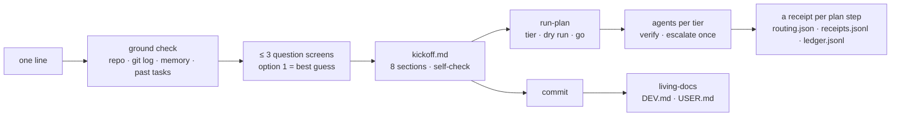

<p align="center"><strong>smartuse</strong></p>
<p align="center">Use Claude Code smartly: one line in, a planner-grade kickoff out — with a receipt for every run and every plan step.</p>
<p align="center">
<a href="LICENSE"></a>


<a href=".github/workflows/ci.yml"></a>
</p>

> gstack gives you roles. Ruflo gives you a swarm. **smartuse gives you a receipt.**

A planner needs paths, owners, absolute dates, non-goals, gated deliverables and open questions with owners. Nobody types that by hand every time. Half of it is in your repo; the other half is in your head. `make-prompt` greps the first half and asks you a few multiple-choice questions for the second. The result is a spec a fresh session can execute. The other pieces keep the work honest afterwards: docs that update themselves after each commit, a reply voice you choose, a safety floor that fires even in bypass mode, a ledger that shows what every run — and every step of the plan — cost, and a heartbeat that says whether Claude is working, waiting on an agent, waiting on you, or stalled.


<p align="center"><sub>Replay of the real 2026-10-21 bench run (<code>bench/results-example/2026-10-21-csv-export/</code>); rendered from the captured output by <code>scripts/render-demo.py</code>, nothing mocked.</sub></p>

## Install (30 seconds)

```text
/plugin install smartuse --marketplace justyk99/smartuse
```
Or from your shell: `claude plugin marketplace add justyk99/smartuse && claude plugin install smartuse@smartuse`. Then type `/smartuse:make-prompt <one line about the work>`.

## What you get

| Skill | You type | You get |
|---|---|---|
| `make-prompt` | `/smartuse:make-prompt add PWA install to the player site` | a ground check of your repo (reference code, owners from git log, lockfiles, missing tools, past tasks, incidents in memory), ≤ 3 screens of multiple-choice questions where option 1 is Claude's evidence-backed guess and "I don't know" is always allowed, an 8-section kickoff saved in your task folder, a 5-line summary for your team, a 14-line self-check. `quick` = no questions, every guess marked `assumed:`. |
| `run-plan` | `/smartuse:run-plan <task.md> --routing safe` (add `--until-done` for the loop) | a dry-run routing table (unit → judgment / build / mechanical / verify → model → why), then foreground agents with a model per tier, one escalation, a fresh-agent review of every delegated build, **a receipt per plan step** (tier · model · your override · outcome · escalation · review verdict · the agent's real tokens, attached by a hook), one progress line per unit. `--routing off` is the baseline for your own A/B. `--until-done` keeps going without "go": a Stop gate refuses to end the turn while units or the repo check are unfinished; it stops only for a real human question, a double failure, a rule gate or the cap. |
| `living-docs` | Claude calls it after a commit it makes; for your own commits run `/smartuse:living-docs <task-folder> <commit>` or add that line to your commit procedure | `DEV.md` (developers) + `USER.md` (operators) per feature, only the sections the diff touched, from the diff + task notes; forked on a cheaper model |
| `reply-style` | `/smartuse:reply-style` | 7 voices (lcd · bluf · engineer · teacher · minimal · plain · memo) with who-they-are-for and pros/cons, installed as a Claude Code output style |
| `ledger` | `/smartuse:ledger` | every run's minutes, fresh vs cached input, output tokens and self-check, with medians. Written by a Stop hook from the session transcript; costs 0 model tokens |
| `receipts` | `/smartuse:receipts [task]` | one row per plan step of a run: `# · step · tier · model · override · outcome · esc · verify · calls · in · out · check`, plus each model's share of agent output. Tokens come from the SubagentStop hook, never estimated; closed runs are archived so a task's receipts survive the next run. 0 model tokens |
| `status` | `/smartuse:status` (add `install` for the terminal status line) | one deterministic line from the heartbeat hook: `working · waiting on agent: general-purpose 4m12s · step 3/6 build·opus "tests"`, `waiting on you · 3m`, `NEEDS YOU: which rounding rule?`, `stalled? no activity 6m`. Hooks on every tool call, agent start/stop, prompt, stop and notification write `status.json`; 0 model tokens, ~80 ms per event through the launcher. The plugin also ships a `subagentStatusLine` that names the plan step on each agent row |
| `bash-guard` | always on | denies pipe-to-shell, `sudo`, recursive deletes of a tree, world-writable chmod, credential-file reads, destructive SQL through shell tools, force-push, svn revert, writes to the human-only adapter — and names the safe alternative. 94 regression cases. `file-guard` keeps the adapter and the pin file read-only for the model |

## How it works



## Measured (2026-10-15, Claude Code 2.1.300, Max plan)

| What | Result |
|---|---|
| `claude plugin eval`, 4 cases, with vs without the plugin (0.2.0, 2026-10-15) | **4 of 4 pass with it** (1.00 each); without: 0.00 / 0.00 / 0.50 / 0.00 · mean gain **+0.88** · $1.27 list price per full run. The 3 cases added in 0.4.0 (`ledger-empty`, `status-line`, `run-plan-no-task`) are not scored yet |
| `make-prompt quick` on three real asks (two production repos + the bench repo) | 0.9 – 1.8 min · 3.1k – 3.9k output tokens · 130k – 205k cached reads each · self-check 11/13 – 12/13 (the receipt's denominator at the time; the list has 14 lines and the receipt says /14 since 0.4.0) |
| `run-plan` first real unit | tiered to Haiku (7 calls, 24k output tokens), reported **blocked** by a read-only database rule instead of working around it |
| `run-plan --until-done`, bench repo, one line in | kickoff 14/14 → endpoint + 4 tests built (11/11 pass) → verified end to end → stopped with a precise human question (pre-existing lint gap). $1.30, 5.6 min, 19 turns. `bench/results-example/` |
| **0.3.0 run (2026-10-21, 2.1.306), same ask, headless** | kickoff 14/14 ($1.57, 2.4 min) → 6 steps, no "go" in between: router + mount + 4 tests (6/6), live curl, three fresh-agent reviews "no gaps", docs on haiku, step 6 blocked by rule (never commits). **A receipt per step with hook-attached tokens**: agent out 10.0k (fable 40% · haiku 45% · sonnet 13%). $3.72, 6.4 min, 22 turns. `bench/results-example/2026-10-21-csv-export/` |
| **A/B, routed vs not, 2026-10-22, model pinned to Opus, 4 bench asks** | same kickoff per ask, then `run-plan --until-done` per dial: median cost `off` $1.35 · `safe` $1.10 · `aggressive` $1.26 — **−24 % median per ask on both routed dials**; agent output not lower (cheaper models wrote more); tests green in 11 of 12 runs (one aggressive run left 3 failing tests); 3 of 4 asks ended on a real human question on every dial. n=4 on one fixture repo: a direction, not a claim. `bench/results-example/2026-10-22-ab-run3/` (and run 2, n=1: −17 % / −31 %) |
| bash-guard · file-guard · ledger + receipts · until-done · heartbeat hooks · bench A/B dry run | 94 / 94 · 10 / 10 · 28 / 28 · 32 / 32 · 66 / 66 · 36 / 36 cases — `bash plugins/smartuse/hooks/tests/all.sh` prints `run 94 · ledger 28 · until-done 32 · file-guard 10 · heartbeat 66 · ab 36` (PASS lines per suite, 2026-10-22) |

Re-run them yourself: `claude plugin eval plugins/smartuse --runs 1 --allow-tools "Bash,Read,Grep,Glob,Agent,Write,Skill"` (Linux needs `bubblewrap` + `socat` for the sandbox) and `bench/run.sh` (a sample repo with a planted rounding bug + 5 asks). The regression suites: `bash plugins/smartuse/hooks/tests/all.sh` — the five hook suites plus the bench A/B dry run, one summary line, nothing spent.

## Honest limits
- Skills and styles are instructions. The hook is the only enforcement.
- `make-prompt quick` reads a lot: budget 1–8 minutes and real plan usage per kickoff. It refuses one-file fixes.
- Subagents cannot ask you questions. Unknowns come back as `unknown: … → who`.
- Routing is measured on **four** bench asks so far (median cost −24 % on both routed dials, agent output not lower, one aggressive run left failing tests); real-repo runs decide whether that holds. The cost column is the session's own `total_cost_usd`, not an estimate. The per-step receipts exist so that every published number has a line of evidence per step.

## Windows
The hooks run through `plugins/smartuse/hooks/py.sh`, which picks `python3`, `python` or `py -3` (on a stock Windows install `python3` is the Microsoft Store stub). Git Bash is required: Claude Code runs hook commands through it on Windows. `HOME` from Git Bash is honoured; state lives under `~/.claude/smartuse/`.

## Configure per repo (optional)
`.claude/smartuse.local.md` with YAML frontmatter: `vcs`, `task_root`, `archive_root`, `docs_root`, `task_template`, `svn_flags`, `author`, `jira_cli`, `check` (the runnable check `run-plan --until-done` must pass, e.g. `npm test`). Without it the skills detect git/svn and the usual folders. Everything the hooks write lives under `~/.claude/smartuse/`, never inside your repo: `ledger.jsonl` (one line per run, all repos) and, per repo under `projects/<key>/`, `routing.json` (the active or latest run-plan run) · `receipts.jsonl` (one line per agent) · `runs/` (closed runs, archived) · `status.json` (the heartbeat) · `pending.json` (a skill's hand-off, consumed by the Stop hook). `<key>` is a key derived from the repository's full path; older versions used the folder name, so a repo's state moves to a new key the first time 0.4.0 runs in it.

## Repository map
```
plugins/smartuse/      the plugin: skills/ (7: make-prompt · run-plan · living-docs · reply-style · ledger · receipts · status) · output-styles/ (7) ·
                       hooks/ (5: bash-guard · file-guard · ledger · until-done · heartbeat; tests/ with all.sh) · evals/ (7 cases) · docs/
bench/                 reproducible mini-benchmark: sample repo + 5 asks + runner
docs/research/         the reading behind the design (reply styles, security profiles, the routing landscape)
docs/notes/            design notes with test logs (4: make-prompt, living-docs, receipts, heartbeat)
docs/releases/         release notes per version
scripts/               2: term-scan.py — private-term scan before a public push · render-demo.py — the demo gif from a captured run
```

## Roadmap
- **0.2**: make-prompt · run-plan · living-docs · reply-style · ledger · bash-guard · evals · bench.
- **0.3** (this release): a receipt per plan step with the user-override field, `/smartuse:receipts` per task, `run-plan --until-done` with its deterministic Stop gate, `file-guard`.
- **0.4** (in progress): the heartbeat (`/smartuse:status`, status line, agent rows) · `bench/ab.sh`, the routed-vs-not A/B runner with the per-step receipts as evidence · receipts by model. Then: the measured A/B numbers, "30 days of receipts", the measured post.

## Contributing
Issues and PRs welcome — see [CONTRIBUTING.md](CONTRIBUTING.md). Every change to a hook needs its test (`plugins/smartuse/hooks/tests/`; `bash plugins/smartuse/hooks/tests/all.sh` runs every suite). Security reports: [SECURITY.md](SECURITY.md).

## Credits and prior art
Built on Claude Code's official mechanisms only (skills, hooks, output styles, plugin evals). Ideas acknowledged: Anthropic's "let Claude interview you" pattern, the Living Docs template (Diew), superpowers `brainstorming` (obra), NawkaRouter / claude-router / gearbox for the routing-ladder shape, gstack for proving that a story and a 30-second install matter, Shape Up for appetite · rabbit holes · no-gos. Details and sources in `docs/research/`.

## Author
JustYK — a full-stack developer who grew this inside a legacy ASP.NET back office and a Vue 3 / .NET 8 rebuild, one incident at a time. MIT.
